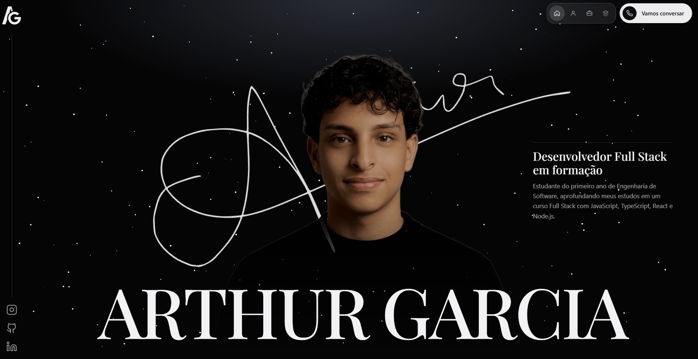

<div align="center">

# Arthur Garcia · Portfólio

**Portfólio pessoal de um desenvolvedor Full Stack em formação.**
Página única, feita à mão com HTML, CSS e JavaScript, sem frameworks.


</div>

---

## Prévia



## Sobre o projeto

Este é o meu portfólio pessoal, desenvolvido como trabalho da faculdade de Engenharia de Software e também como a minha vitrine profissional. Queria um site com identidade própria, **profissional e artístico ao mesmo tempo**, e aproveitei o projeto para aprender animações e layout responsivo na prática.

O desenvolvimento foi feito **em blocos**: criei e ajustei cada parte separadamente (cabeçalho, hero, sobre, projetos, contato)

## O que tem no site

- **Hero** com fundo de estrelas em movimento desenhado em `<canvas>`, retrato recortado, assinatura animada e nome em destaque.
- **Cabeçalho** que vira uma pílula expansível no computador e um menu em painel no celular.
- **Barra lateral fixa** com a logo e as redes sociais (no computador).
- **Sobre mim** com apresentação e uma faixa infinita com as ferramentas que uso no dia a dia.
- **Projetos** em cards, com link para o repositório de cada um e aviso nos que ainda estão em desenvolvimento.
- **Contato** com formulário que abre o aplicativo de e-mail com a mensagem pronta.

## Tecnologias

| Para quê | O que usei |
| --- | --- |
| Estrutura | HTML5 semântico |
| Estilo e layout | CSS3 (Grid, Flexbox, variáveis, `clamp()`, `mask-image`) |
| Interação e animação | JavaScript puro (`canvas`, `requestAnimationFrame`, `IntersectionObserver`) |
| Tipografia | Playfair Display e Raleway (Google Fonts) |
| Ícones | SVG locais (Devicon) |

## Decisões de projeto

- **Sem frameworks, por enquanto.** Quis consolidar a base de HTML, CSS e JavaScript antes de partir para frameworks como o React.

- **Estrelas em `<canvas>` em vez de uma biblioteca.** Foi a forma de aprender como funciona um loop de animação

- **Formulário com `mailto:`.** Não precisa de servidor, mas depende de o visitante ter um aplicativo de e-mail configurado. O e-mail fica visível ao lado como alternativa.

- **Página única.** Os estudos de caso detalhados ficam para uma próxima etapa. Por enquanto, cada projeto aponta para o seu repositório e README.


## Estrutura de pastas


```
portfolio/
├── index.html          
├── css/
│   └── style.css  
├── js/
│   └── script.js
├── docs/
│   └── Portfolio.png    
└── assets/
    ├── images/         
    └── icones/   
```

## Como rodar

Não há dependências nem etapa de build. Basta clonar e abrir o arquivo no navegador:

```bash
git clone https://github.com/arthurgarciadev/portifolio
```

Depois abra o `index.html`. Se preferir um servidor local, a extensão **Live Server** do VS Code funciona bem.

## O que aprendi

- Montar layouts responsivos com Grid, Flexbox.
- Criar animações em CSS, e cuidar do desempenho delas.
- Pensar em acessibilidade desde o começo, e não só no final.
- Organizar um projeto em blocos e versionar a evolução com Git.
- aprendi a trabalhar melhor com ferramentas de IA.

## Uso de IA

Usei inteligência artificial (Claude e ChatGPT) como apoio durante o desenvolvimento: para planejar a estrutura do site, tirar dúvidas e melhorar a qualidade do código. Parte do objetivo deste projeto era justamente aprender a trabalhar melhor com essas ferramentas, ou seja, entender o que recebo, testar, corrigir e adaptar o resultado. O design partiu dos meus mockups e referências, e as decisões de conteúdo e os ajustes finais no código foram feitos por mim. O retrato do hero foi criado com o Gemini.

## Próximos passos

- [ ] Pausar as estrelas do hero para quem ativa "reduzir movimento" no sistema.
- [ ] Trocar o `mailto:` por um serviço de formulário (como Formspree) para funcionar sem aplicativo de e-mail.
- [ ] Escrever estudos de caso para os principais projetos.
- [ ] Adicionar um chat com IA que responda sobre mim, usando uma função no servidor para proteger a chave da API.
- [ ] Reescrever o site em React, quando eu estiver mais confortável com a biblioteca.

## Créditos

- Ícones das tecnologias: [Devicon](https://devicon.dev/) (licença MIT).
- Fontes: [Playfair Display](https://fonts.google.com/specimen/Playfair+Display) e [Raleway](https://fonts.google.com/specimen/Raleway) (SIL Open Font License).

## Contato

**Arthur Garcia** · Maringá, Paraná

- E-mail: [arthurgarcia.dev@gmail.com](mailto:arthurgarcia.dev@gmail.com)
- LinkedIn: [linkedin.com/in/arthurgarciadev](https://www.linkedin.com/in/arthurgarciadev)
- GitHub: [github.com/arthurgarciadev](https://github.com/arthurgarciadev)
